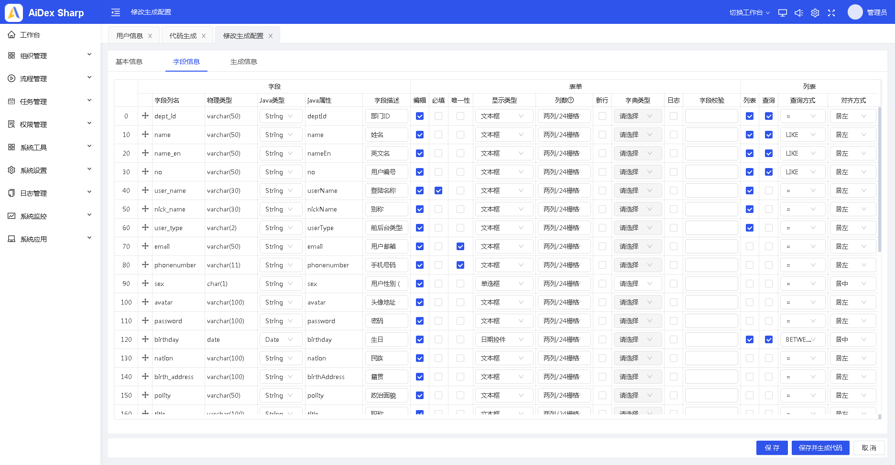
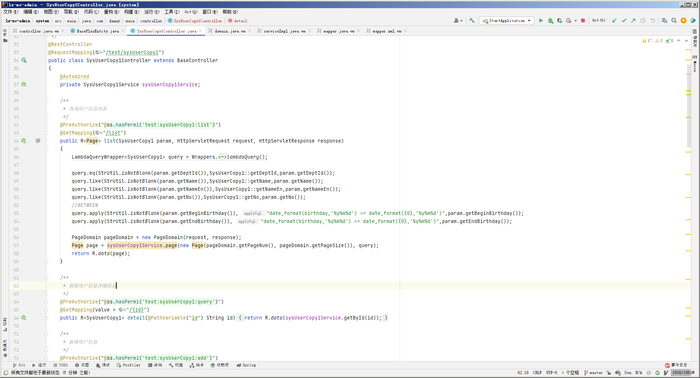
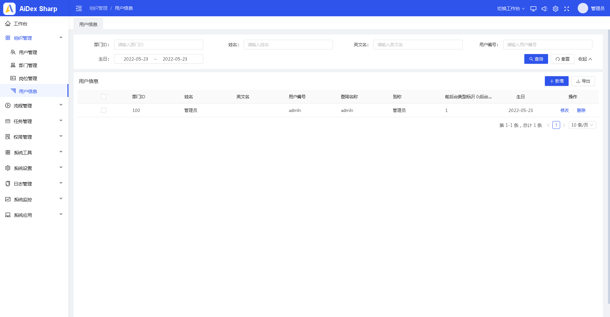

<div align="center"><h3 align="center">快速开发平台</h3></div>
<div align="center"><h3 align="center">基于若依扩展的Spring Boot前后端分离架构，代码精简，开箱即用，紧随前沿技术</h3></div>


## 后续开发计划(年前暂时不更了没有时间。年后再说吧);年后发现更忙了~~~

### 更新日志
* 2022年5月20日 年后第一次更新~~修复各种无法启动，流程优化等~
* 2022年5月23日 修改生成模块生成为mybatisplus模板（告别传统查询方式超级简洁）
*  **2022年8月24日 媳妇快生了本项目暂停更新，正在架构全新的后台脚手架技术结构打算用前端：uniapp vue3+ts全尺寸适配 +后端：(springboot or jfinal)；** 


### 数据预警拦截


* 完善流程管理
* 流程管理前端elment-ui转ant(有没有前端小伙一起弄)集成（XRender）
* 报表模块开发（开发中）
* 托拉拽数据大屏设计（开发中）
* 数据模板开发
## 平台简介

 **快速开发平台** 基于开源项目“ **AiDex Sharp 快速开发平台** ”改造而成，**集成flowable、mybatis-plus** 。

* 感谢[RuoYi-Vue](https://gitee.com/y_project/RuoYi-Vue)
* 感谢[RuoYi-Antdv](https://gitee.com/fuzui/RuoYi-Antdv)
* 感谢[aidex-sharp](https://gitee.com/big-hedgehog/aidex-sharp)

## 联系我们


## 官方QQ群

## 系统截图

<table>
    <tr>
        <td></td>
        <td></td>
    </tr>
    <tr>
        <td></td>
        <td></td>
    </tr>
	<tr>
        <td></td>
        <td></td>
    </tr>	 
</table>
更多功能请访问系统体验

## 在线体验


## 框架优势

* 基于RuoYi-Vue和Ant Design Vue Pro的结合，并进行了UI交互的深度改造。
* 高效率开发，使用代码生成器可以一键生成前后端代码，可在线预览代码。
* 代码生成器：自动包含规范，可根据以下规则自动设置：居中、居左、居右，列表页面遵循一下对齐格式：
  > 1.  居中显示：短小字符居中（用户名）、通用代码、日期时间、数值位数相等的字段（如：编码、编号）、整数型数字（如年龄，个数）
  > 2.  居左：比较长的字符居左（备注等），部门名称、名称、标题
  > 3.  居右：货币或带小数点的数字居右，如带小数点的数字，数量、百分数
* 代码生成器：支撑自动选择图标，挂载菜单。
* 代码生成器：支持列拖拽，方便表单和列表页面的列排序。
* 代码生成器：可自定义选择生成唯一性校验代码，减少代码开发量。
* 列显示定义：用户可自定义列选择和列定义。
* 表头排序：支持服务端表头排序。
* 文件中心：内置异步导入和导出的文件管理中心，所有下载附件均以异步任务方式进行提交管理，类似于阿里云的账单中心功能。
* 代码优化：优化Mapper中的SQL，对各种方法进行片段化管理，最大限度精简方法，提升代码整洁度。
* 缓存工具类抽取。
* base类抽取：抽取baseEntity，BaseService，BaseMapper，提出公共方法，减少代码量。
* 缓存Key监控：监控系统中的缓存信息，并可以删除key，预览缓存内容。
* 特别鸣谢：[RuoYi-Vue](https://gitee.com/y_project/RuoYi-Vue)。
* 特别鸣谢：[RuoYi-Antdv](https://gitee.com/fuzui/RuoYi-Antdv)。
* 特别鸣谢：[aidex-sharp](https://gitee.com/big-hedgehog/aidex-sharp)。


## 内置功能

斜体为重点增强优化功能

1. _用户管理：用户是系统操作者，该功能主要完成系统用户配置。_
2. _部门管理：配置系统组织机构（公司、部门、小组），树结构展现支持数据权限。_
3. _岗位管理：配置系统用户所属担任职务。_
4. _菜单管理：配置系统菜单，操作权限，按钮权限标识等。_
5. _角色管理：角色菜单权限分配、设置角色按机构进行数据范围权限划分。_
6. _字典管理：对系统中经常使用的一些较为固定的数据进行维护。_
7. _参数管理：对系统动态配置常用参数。_
8. 通知公告：系统通知公告信息发布维护。
9. 操作日志：系统正常操作日志记录和查询；系统异常信息日志记录和查询。
10. _登录日志：系统登录日志记录查询包含登录异常。_
11. 在线用户：当前系统中活跃用户状态监控。
12. _定时任务：在线（添加、修改、删除)任务调度包含执行结果日志。_
13. _代码生成：前后端代码的生成（java、html、xml、sql）支持CRUD下载 。_
14. 系统接口：根据业务代码自动生成相关的api接口文档。
15. _服务监控：监视当前系统CPU、内存、磁盘、堆栈等相关信息。_
16. _缓存监控：对系统的缓存信息查询，命令统计等。_
17. _缓存列表：对系统的缓存信息查询，命令统计等。_
18. 在线构建器：拖动表单元素生成相应的HTML代码。
19. 连接池监视：监视当前系统数据库连接池状态，可进行分析SQL找出系统性能瓶颈。
20. 流程管理：对于流程定义流转等。


---
前端工程结构
---

```
├── public
│   └── logo.png             # LOGO
|   └── index.html           # Vue 入口模板
├── src
│   ├── api                  # Api ajax 等
│   ├── assets               # 本地静态资源
│   ├── config               # 项目基础配置，包含路由，全局设置
│   ├── components           # 业务通用组件
│   ├── core                 # 项目引导, 全局配置初始化，依赖包引入等
│   ├── directive            # 自定义指令
│   ├── router               # Vue-Router
│   ├── store                # Vuex
│   ├── utils                # 工具库
│   ├── locales              # 国际化资源
│   ├── views                # 业务页面入口和常用模板
│   ├── App.vue              # Vue 模板入口
│   └── main.js              # Vue 入口 JS
│   └── permission.js        # 路由守卫(路由权限控制)
│   └── global.less          # 全局样式
├── tests                    # 测试工具
├── README.md
└── package.json
```

## 后端工程结构

| 项目 | 说明 |
| --- | --- |
| `admin` | 系统启动入口 |
| `common` | 工具类 |
| `controller` | 前台控制器 |
| `flowable` | 流程控制器 |
| `framework` | 框架核心 |
| `generator` | 代码生成工具 |
| `quartz` | 定时任务|
| `system` | 系统管理 |

更多功能请访问系统。

---
系统在线文档
---
* 文档地址（参考若依）：<http://doc.ruoyi.vip/> 
* RuoYi-Vue文档：[https://doc.ruoyi.vip/ruoyi-vue/](https://doc.ruoyi.vip/ruoyi-vue/)
* Ant Design Vue文档：[https://www.antdv.com/docs/vue/introduce-cn/](https://www.antdv.com/docs/vue/introduce-cn/)
* [《如何搭建环境》](http://doc.ruoyi.vip/ruoyi-vue/document/hjbs.html)
* [《常见问题》](http://doc.ruoyi.vip/ruoyi-vue/document/hjbs.html#%E5%B8%B8%E8%A7%81%E9%97%AE%E9%A2%98)

 **> 未来会补充文档和视频，方便友友们使用！** 


## 平台官网

  …………正在构建中，敬请期待…………

---
版权说明
---

* Aidex Sharp快速开发平台采用GPL技术协议。
* 代码可用于个人项目等接私活或企业项目脚手架使用，Aidex Sharp全系开源版完全免费。
* 二次开发如用于商业性质或开源竞品请先联系群主审核。
* 允许进行商用，但是不允许二次开源出来并进行收费
* 请不要删除和修改Aidex Sharp源码头部的版权与作者声明及出处。
* 不得进行简单修改包装声称是自己的项目。
* 我们已经申请了相关的软件开发著作权和相关登记
---
参与贡献
---
欢迎各路英雄好汉参与代码贡献，期待您的加入！
Fork 本仓库
新建 Feat_xxx 分支
提交代码
新建 Pull Request