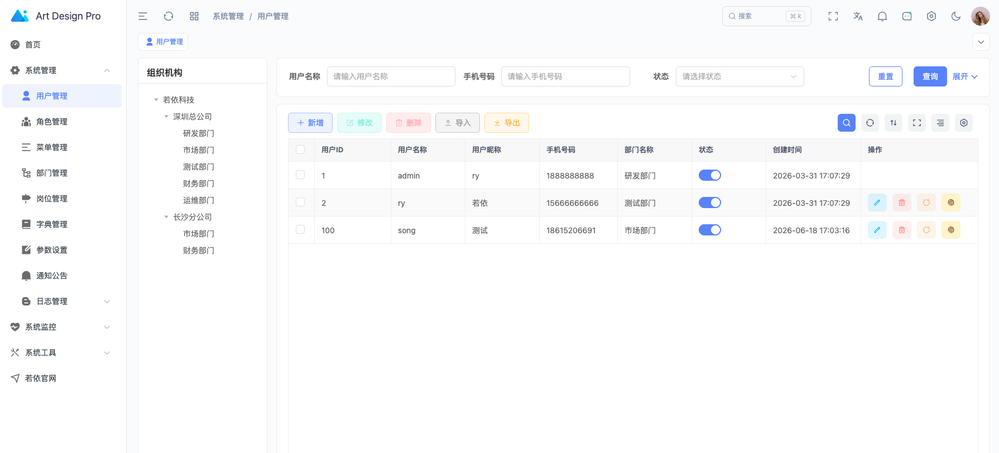
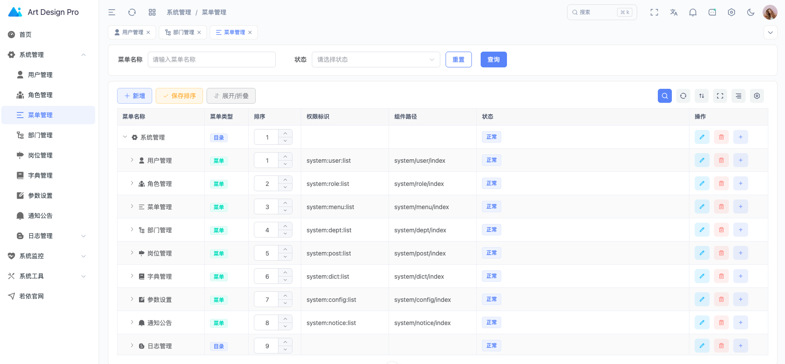
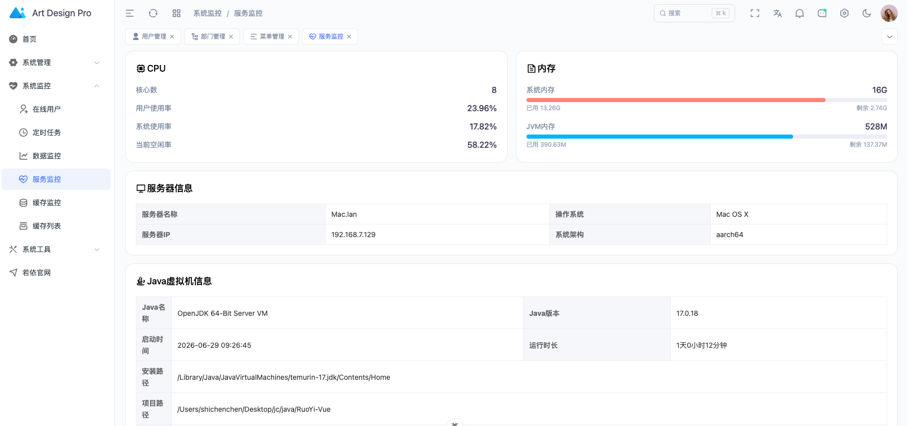
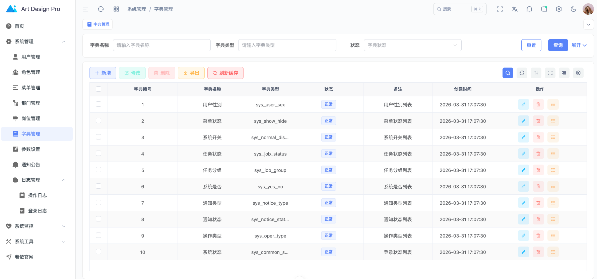
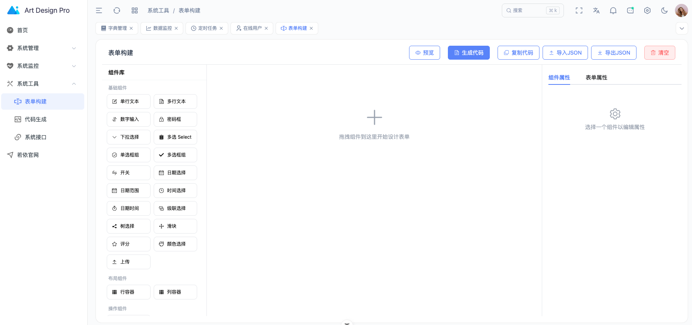
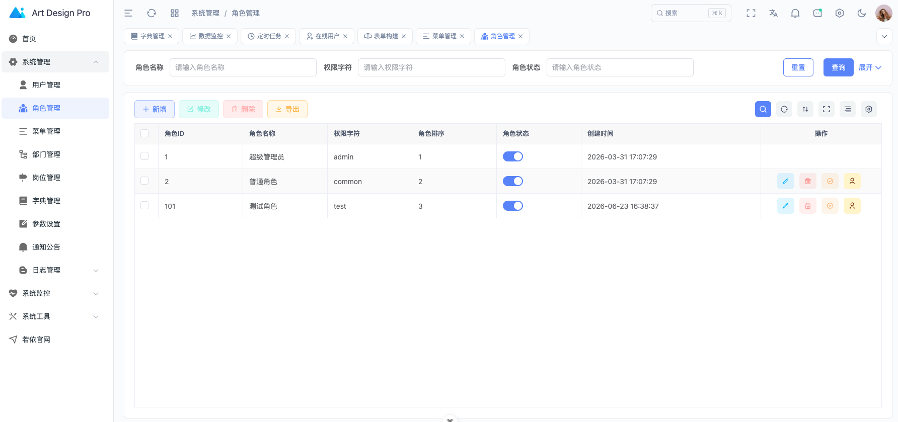
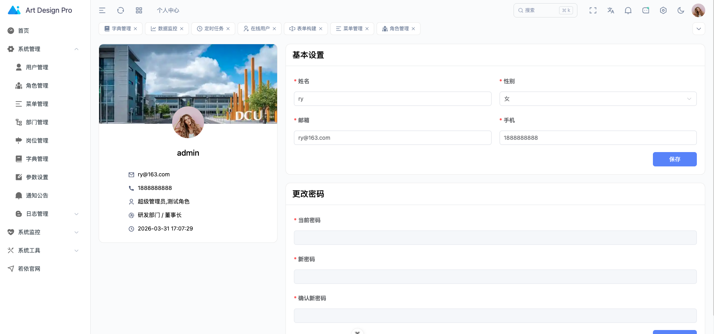

<h1 align="center">RuoYi Art Design Pro</h1>

<p align="center">
  <a href="https://www.artd.pro" target="_blank">官网</a> ·
  <a href="https://www.artd.pro/docs/zh/" target="_blank">文档</a> ·
  <a href="https://www.artd.pro/docs/zh/guide/introduce.html" target="_blank">项目介绍</a> ·
  <a href="https://github.com/Daymychen/art-design-pro" target="_blank">GitHub</a> ·
  <a href="http://ruoyi.vip" target="_blank">若依官网</a>
</p>

<p align="center">
  
  
  
  
  
  
  
</p>

## 简介

**RuoYi Art Design Pro** 是基于 [若依 (RuoYi)](http://ruoyi.vip) 前后端分离版本的 Vue 前端，使用 **Art Design Pro** 设计体系进行全面重写的高级中后台管理系统。

项目融合了若依成熟的后端权限体系与 Art Design Pro 现代化的前端架构与 UI 设计，提供开箱即用的企业级开发体验。

### 特性

- 🎨 **Art Design Pro 设计体系** — 基于 Art Design Pro 规范，提供现代化 UI 风格
- 🧩 **Vue 3 + TypeScript** — 最新技术栈，完整的类型推导与 IDE 支持
- ⚡ **Vite 7** — 极速开发体验，毫秒级 HMR
- 🎭 **Element Plus** — 企业级 UI 组件库，开箱即用
- 🎨 **Tailwind CSS 4** — 原子化 CSS，快速构建自定义样式
- 🌓 **深色模式** — 完善的明暗主题切换，无闪烁加载
- 🌍 **国际化** — 基于 vue-i18n 的多语言支持
- 📦 **Pinia** — 类型安全的状态管理
- 📊 **ECharts 6** — 强大的数据可视化能力
- 🔧 **Oxlint + Oxfmt** — Rust 高性能代码检查与格式化
- 🎯 **若依权限体系** — 完整兼容若依后端 RBAC 权限模型

## 预览

|              登录页              |              工作台              |
| :------------------------------: | :------------------------------: |
|  |  |

|              菜单管理              |              角色管理              |
| :--------------------------------: | :--------------------------------: |
|  |  |

|              用户管理              |              系统监控              |
| :--------------------------------: | :--------------------------------: |
|  |  |

|              更多功能              |
| :--------------------------------: |
|  |

## 快速开始

### 环境要求

- **Node.js** >= 20.19.0
- **pnpm** >= 10.14.0

### 安装与运行

```bash
# 克隆项目
git clone https://github.com/Daymychen/art-design-pro.git

# 进入目录
cd art-design-pro

# 安装依赖
pnpm install

# 启动开发服务
pnpm dev

# 构建生产环境
pnpm build

# 代码检查
pnpm lint

# 代码格式化
pnpm fmt
```

## 技术栈

| 技术         |  版本   | 用途         |
| :----------- | :-----: | :----------- |
| Vue          | ^3.5.21 | 前端框架     |
| TypeScript   | ^6.0.3  | 类型系统     |
| Vite         | ^7.1.5  | 构建工具     |
| Element Plus | ^2.11.2 | UI 组件库    |
| Tailwind CSS | ^4.1.14 | 原子化 CSS   |
| Pinia        | ^3.0.3  | 状态管理     |
| Vue Router   | ^4.5.1  | 路由         |
| vue-i18n     | ^9.14.0 | 国际化       |
| ECharts      | ^6.0.0  | 图表         |
| Axios        | ^1.12.2 | HTTP 请求    |
| wangEditor   | latest  | 富文本编辑器 |
| xgplayer     | ^3.0.20 | 视频播放     |
| xlsx         | ^0.18.5 | 表格导出     |
| oxlint       | latest  | 代码检查     |
| oxfmt        | latest  | 代码格式化   |

## 目录结构

```
src/
├── api/              # API 请求模块
├── assets/           # 静态资源（图片、样式、图标）
├── components/       # 公共组件
│   └── core/         #   核心基础组件
├── config/           # 应用配置
├── directives/       # 自定义指令
├── enums/            # 枚举定义
├── hooks/            # 可组合函数
├── locales/          # 国际化语言包
├── mock/             # Mock 数据
├── plugins/          # 插件
├── router/           # 路由配置
├── store/            # Pinia 状态管理
├── types/            # TypeScript 类型定义
├── utils/            # 工具函数
└── views/            # 页面视图
```
