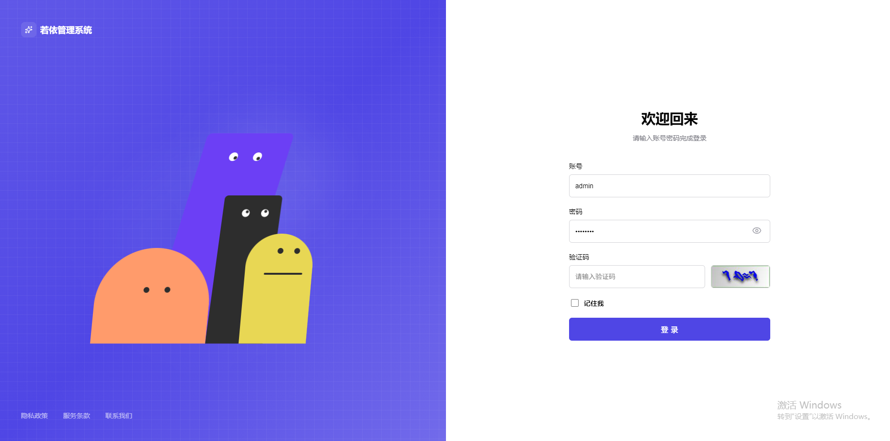

## 平台简介
一个有趣的登录页面，集成若依框架。带有交互式卡通角色，眼睛会跟随鼠标移动、随机眨眼，并对用户输入做出反应。

使用 Vue 3 + TypeScript + 原生 CSS。

## 参考项目
后端：https://gitee.com/y_project/RuoYi-Vue.git

前端：https://gitcode.com/yangzongzhuan/RuoYi-Vue3.git

登录：https://gitee.com/niumg9527/login-animation.git

## 效果展示
