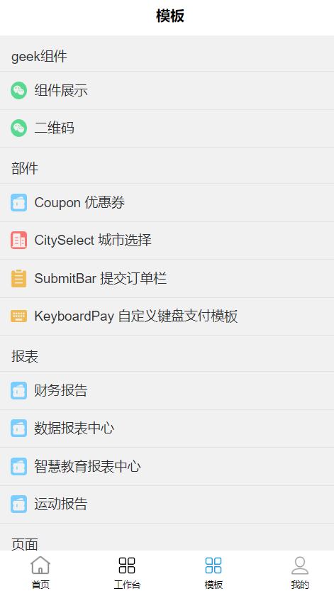
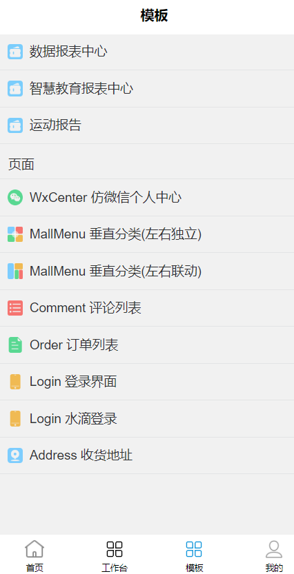
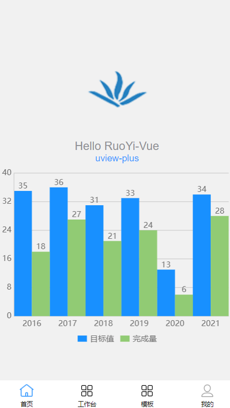
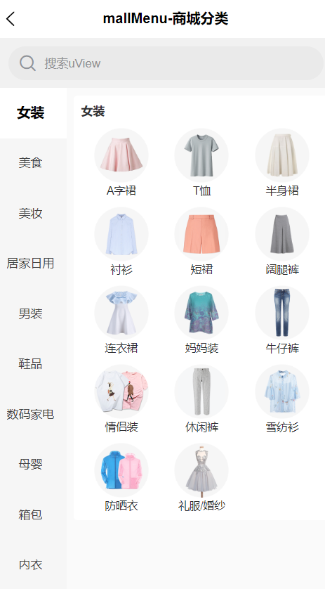

# RuoYi-App-Geek

<p align="center">
    <span>
        
    </span>
    <span>+</span>
    <span>
        
    </span>
</p>
<h1 align="center" style="margin: 30px 0 30px; font-weight: bold;">RuoYi-Geek v3.8.7.3.2</h1>
<h4 align="center">基于SpringBoot3+Vue3前后端分离的Java快速开发框架</h4>
<p align="center">
	
</p>

# 引言

RuoYi-Vue 与 RuoYi-App 是基于 SpringBoot2+Vue2 打造的企业级开发框架，得到了广大开发者的喜爱和积极反馈。随着技术的迭代进步，SpringBoot3 与 Vue3 逐渐进入开发者的视野。为了满足开发者对于新技术的追求，RuoYi 官方文档提供了 SpringBoot2 至 SpringBoot3 的升级方法。与此同时，社区也涌现出了 RuoYi-Vue3、RuoYi-App-Vue3 的版本，展现了开发者社区对于技术升级的热情与努力。

然而，在升级的过程中，官方的方法为了兼顾 Java1.8 的特性与一些老旧的方法，未完全拥抱**SpringBoot3 与 Java17**的全部特性。而社区的 RuoYi-Vue3、RuoYi-App-Vue3 版本由于出自不同的团队之手，**兼容性及整合性**上存在些许**不足**。更为关键的是，尽管这些版本**支持 TypeScript**，但**缺乏与之相匹配的 tsconfig.json 配置文件**，这使得在主流编辑器如 VSCode 中，TypeScript 的语法提示环境并未达到最佳状态。

鉴于此，**RuoYi-Geek 生态**应运而生。它旨在为广大开发者提供一个既保留原版本核心特性，又整合社区版优点的全新解决方案。在**RuoYi-Geek**中，我们深入调研了企业开发中常用的 RuoYi 扩展，并直接在框架中集成，确保开发者能够快速上手，高效开发。同时，我们采用了最新的**SpringBoot3+Vue3**技术栈，彻底移除了为了兼容 Java1.8 而保留的老旧方法。更为重要的是，我们为 TypeScript 开发环境加入了常用的 tsconfig.json 配置，使得开发者在 VSCode 等编辑器中能够获得更为舒适、便捷的语法提示体验。

**RuoYi-Geek**不仅仅是一个简单的升级版本，更是对于 RuoYi 生态的一次全面优化与整合。我们相信，通过**RuoYi-Geek 生态**，开发者将能够更为高效、愉悦地开发出优秀的企业级应用。

本项目为**RuoYi-Geek 生态**的 RuoYi-App 部分。
**注意：**
本人的其他两个推荐搭配的项目

1. [Ruoyi-SpringBoot3-Geek: 这是若依极客生态的后端 Springboot3 版本 (gitee.com)](https://gitee.com/geek-xd/ruoyi-spring-boot3-geek)
2. [RuoYi-Vue3-Geek: 这是若依极客生态的 Vue3 版本 (gitee.com)](https://gitee.com/geek-xd/ruo-yi-vue3-geek)

**与 Ruoyi-App 相比较**

1. 使用 UniApp+Vue3 的最新框架
2. 支持 TS、SCSS、LESS 等对 js 和 css 的扩充语言
3. 使用 Pinia 代替 Vuex，更加轻巧简单
4. 使用 uView-Plus（好看的 ui） 代替 uView-ui 的 ui 组件库
5. 使用 uCharts（方便的图表）画图工具
6. 已经完成了分包操作
7. 提供了颜色选择器、二维码等常用组件
8. 将原有内置工具进行类型标定
9. 分别提供了 uview-plus 和 ucharts 的模板（可以直接使用或者用于学习）

# 快速开始

**注意：** node 版本需要 16+

## 迁移到Hbuilder（不依赖Hbuilder的项目不需要迁移）

1. src路径作为项目根路径
2. 将index.html、package.json、vite.config.js、tsconfig.json、.gitignore粘贴到src目录下
3. 在src目录下运行npm install
4. 修改index.html中的./src/main.js为./main.js
5. 在HBuilderX中运行时注意观察是否使用的是Vue3的编译器（若不是请自行查找方法解决，本人对HbuilderX使用不多）

## 安装

一下三种方式均可，感觉速度 pnpm > yarn > cnpm > npm

**_Vue3/Vite 版要求 node 版本^14.18.0 || >=16.0.0_**

```shell
npm install
cnpm install
yarn
pnpm install
```

# 启动

1. 将项目下载到本地
2. 初始化项目---进入项目根路径运行指令初始化项目
   `npm install`
3. 运行项目---进入项目根路径运行指令（在 package.json 能找到所有指令）：
   以微信小程序为例：`npm run dev:mp-weixin`
   以 H5 为例 ` npm run dev:h5`
4. 查看项目 以微信小程序为例：
   打开微信开发者工具，导入项目路径 dist\dev\mp-weixin
   以 H5 为例：打开浏览器，输入控制台输出的地址
   注：公众号属于 H5，以微信公众号为例，打开微信开发者工具，输入控制台输出的地址
5. 打包项目---进入项目根路径运行指令（在 package.json 能找到所有指令）：
   以微信小程序为例：`npm run build:mp-weixin`
   以 H5 为例： `npm run build:h5`

### 代码压缩

默认是启动代码压缩的，

如果需要关闭代码压缩，可以将 vite.config.js 中的 build.minify 赋值为 false。

如果需要打开代码压缩，可以将 vite.config.js 中的 build.minify 赋值为 true。

# 内置组件(geek-xd)

1. 颜色选择器组件
2. 圆形菜单组件
3. 常用的订单组件
4. 信息展示组件

# 插件的使用

#### tab - 页面插件

可以通过设置参数中的 config.data 来实现页面传参

| 方法         | 作用                                             | 参数        |
| ------------ | ------------------------------------------------ | ----------- |
| getData      | 可以拿到上个页面通过 tab 传递的参数              | 无          |
| reLaunch     | 关闭所有页面，打开到应用内的某个页面             | url、config |
| switchTab    | 跳转到 tabBar 页面，并关闭其他所有非 tabBar 页面 | url、config |
| redirectTo   | 关闭当前页面，跳转到应用内的某个页面             | url、config |
| navigateTo   | 保留当前页面，跳转到应用内的某个页面             | url、config |
| navigateBack | 关闭当前页面，返回上一页面或多级页面             | config      |

#### auth - 鉴权插件

下面所有方法返回值都是布尔值，permission 代表权限字符串，role 代表角色字符串，复数形式代表数组。

| 方法        | 作用                                       | 参数        |
| ----------- | ------------------------------------------ | ----------- |
| hasPermi    | 验证用户是否具备某权限                     | permission  |
| hasPermiOr  | 验证用户是否含有指定权限，只需包含其中一个 | permissions |
| hasPermiAnd | 验证用户是否含有指定权限，必须全部拥有     | permissions |
| hasRole     | 验证用户是否具备某角色                     | role        |
| hasRoleOr   | 验证用户是否含有指定角色，只需包含其中一个 | roles       |
| hasRoleAnd  | roles                                      | roles       |

#### modal - 弹窗插件

content 是消息内容，option 是详细配置。

| 方法         | 作用                           | 参数    |
| ------------ | ------------------------------ | ------- |
| msg          | 消息提示                       | content |
| msgError     | 错误消息                       | content |
| msgSuccess   | 成功消息                       | content |
| hideMsg      | 隐藏消息                       | 无      |
| alert        | 弹出提示                       | content |
| confirm      | 确认窗体                       | content |
| showToast    | 提示信息                       | option  |
| loading      | 打开遮罩层，需要手动关闭遮罩层 | content |
| closeLoading | 关闭遮罩层                     | 无      |

#### bus - 事件插件

eventName 是事件名称，eventFun 是事件处理函数，请尽量避免事件插件的使用，请在组件销毁是解绑素有该组件有关的事件，避免产生 bug。

| 方法  | 作用         | 参数                |
| ----- | ------------ | ------------------- |
| $on   | 绑定一个事件 | eventName、eventFun |
| $off  | 解绑一个事件 | eventName           |
| $emit | 触发一个事件 | eventName、...args  |

#### socket

设置项 enableUUID，是否启用基于 uuid 的消息处理机制，要求当发送的消息携带 uuid 字段时，返回的消息也要携带 uuid 字段。

设置项 enableEvent，是否启用基于事件的消息处理机制，要求当希望被事件处理函数处理的消息需要携带 event 字段。

| 方法      | 作用                                                                                                                    | 参数                                                                                                                                    |
| --------- | ----------------------------------------------------------------------------------------------------------------------- | --------------------------------------------------------------------------------------------------------------------------------------- |
| connect   | 连接 websocke，当连接成功后触发回调函数                                                                                 | 最简单的用法就是传入{url:"ws://demo"}                                                                                                   |
| send      | 发送信息，当 uuid 不为空且不为 false 时，当收到携带相同 uuid 的消息时触发回调函数，只触发一次。否则由默认处理函数处理。 | msg 消息内容，会被处理成 json 字符串 uuid 唯一标识符，可以手动传入，也可以设置为 true 当为 true 时会自动生成一个 uuid 并添加到 msg 中。 |
| close     | 关闭连接，会触发回调函数的内容，不会触发默认关闭事件的处理函数，也不会修改默认关闭事件的处理函数。                      | 无                                                                                                                                      |
| on        | 监听事件，当收到携带 event 的消息时会调用回调函数。                                                                     | event 事件的名称                                                                                                                        |
| off       | 取消监听事件                                                                                                            |                                                                                                                                         |
| onMessage | 定义默认监听事件                                                                                                        | callback 默认监听事件的处理函数                                                                                                         |
| onError   | 定义异常事件                                                                                                            | callback 默认异常事件的处理函数                                                                                                         |
| onClose   | 定义关闭事件                                                                                                            | callback 默认关闭事件的处理函数                                                                                                         |

# 作者建议

### 对于选项式

```js
this.$tab; // 建议使用this.$tab进行页面跳转，理由：便于在跳转前处理其他事务
this.$auth; // 建议使用this.$auth进行鉴权操作
this.$modal; // 建议使用this.$modal打开弹窗，理由：便于以后想要使用自定义弹窗
```

### 对于组合式

```js
import tab from "@/plugins/tab"; // 建议使用tab进行页面跳转，理由：便于在跳转前处理其他事务
import auth from "@/plugins/auth"; // 建议使用auth进行鉴权操作
import modal from "@/plugins/modal"; // 建议使用modal打开弹窗，理由：便于以后想要使用自定义弹窗

// 也可以使用下面的方式
import { tab, auth, modal } from "@/plugins";
```

# 功能演示

<table>
    <tr>
        <td></td>
        <td></td>
    </tr>
    <tr>
        <td></td>
        <td></td>
    </tr>
</table>

# 附录

[Vue3 官网](https://cn.vuejs.org/)；
[uniapp 官网](https://uniapp.dcloud.net.cn/)；
[uView-plus 官网](https://uiadmin.net/uview-plus/)；
[uCharts 官网](https://www.ucharts.cn/v2/#/)；
[RuoYi 官网](http://ruoyi.vip/)；

# 联系我们：

QQ 交流群：744785891
