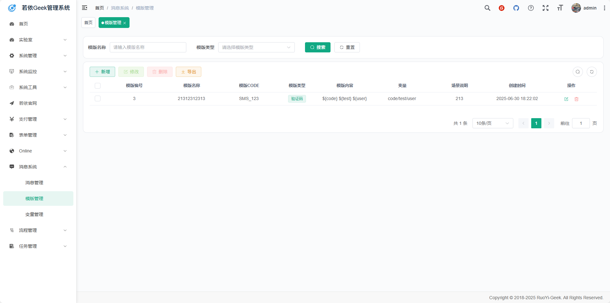
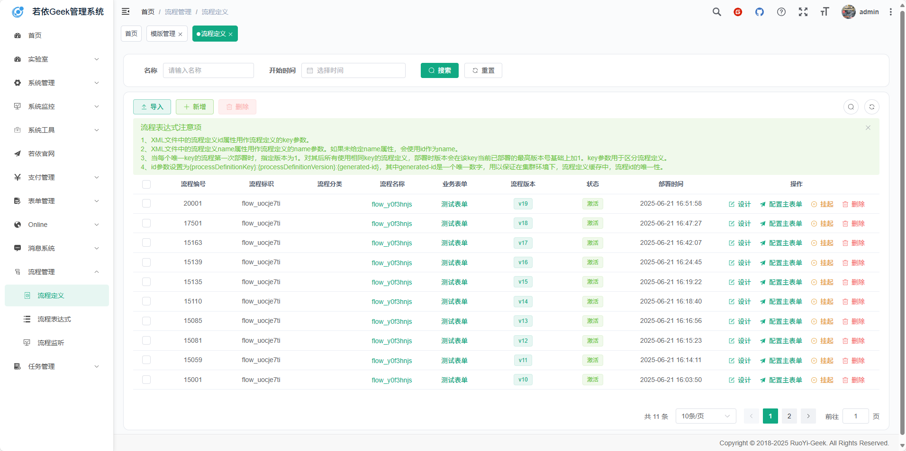
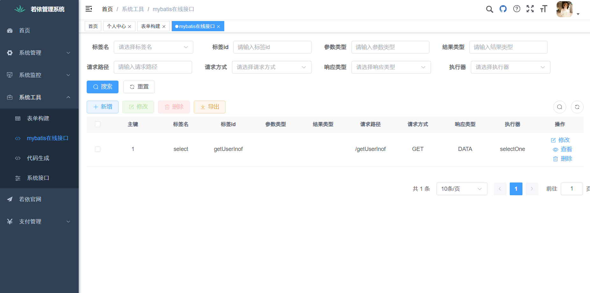
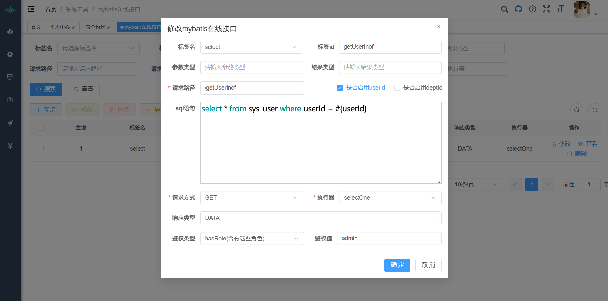
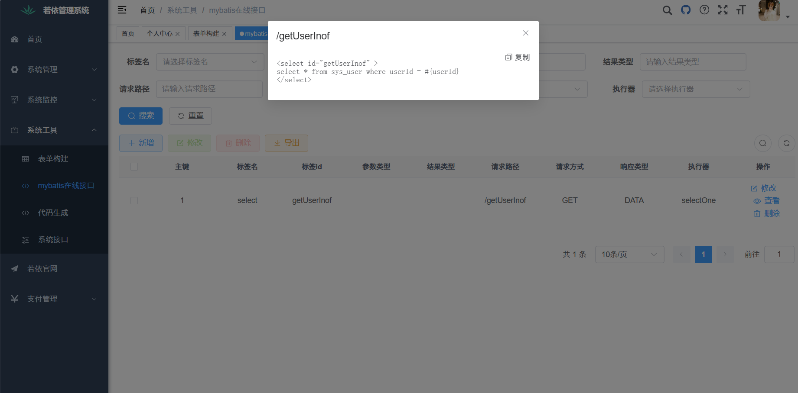
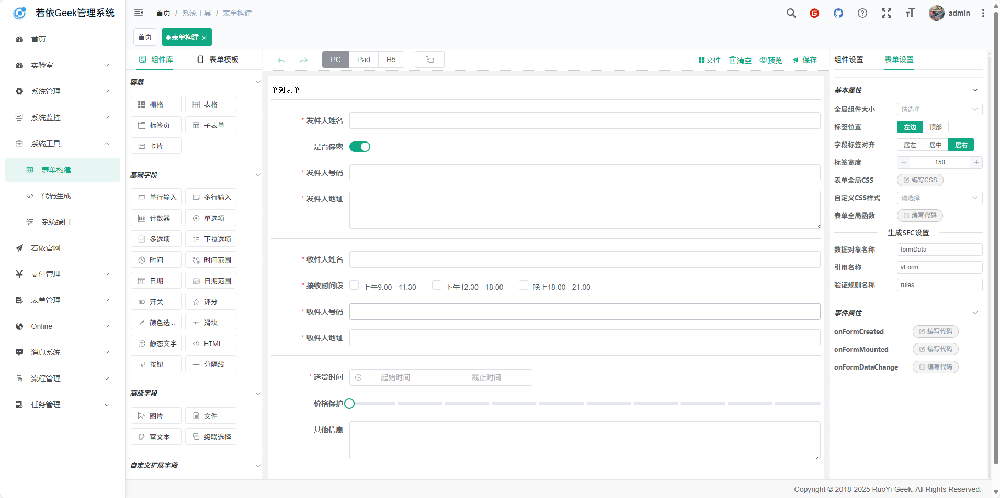
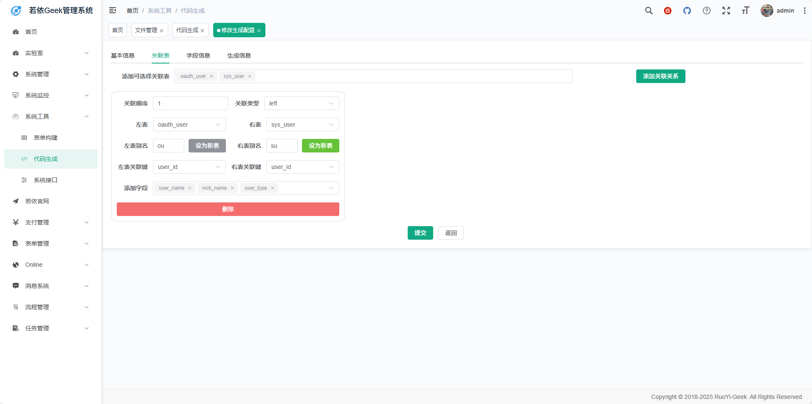
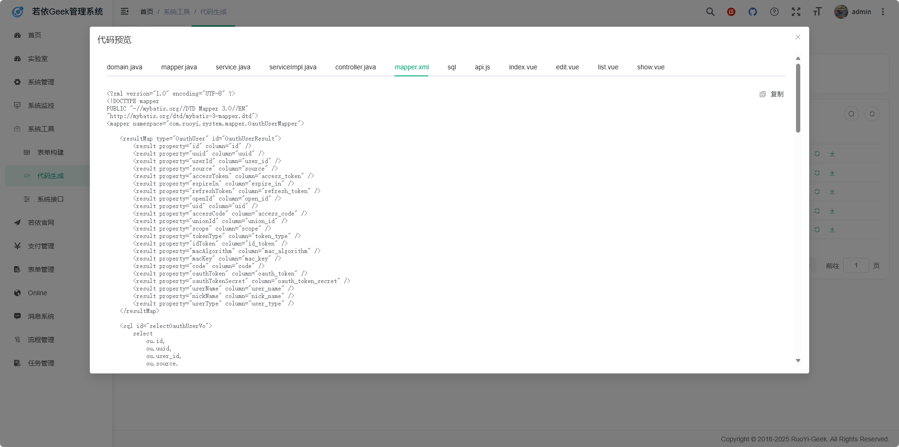

<p align="center">
    <span>
        
    </span>
    <span>+</span>
    <span>
        
    </span>
</p>
<h1 align="center" style="margin: 30px 0 30px; font-weight: bold;">RuoYi-Geek v3.8.9-G</h1>
<h4 align="center">基于SpringBoot3+Vue3前后端分离的Java快速开发框架</h4>
<p align="center">
	
</p>

# 当前版本是3.8.9-G

本人的其他两个推荐搭配的项目

1. [RuoYi-App-Geek: 这是若依极客生态的小程序版本 (gitee.com)](https://gitee.com/geek-xd/geek-uniapp-vue3-uview-plus-uchart)
2. [RuoYi-Vue3-Geek: 这是若依极客生态的Vue3版本 (gitee.com)](https://gitee.com/geek-xd/ruo-yi-vue3-geek)

与本项目同为一个作者开发，兼容性最好，学习成本最低。

# 引言

RuoYi-Vue与RuoYi-App是基于SpringBoot2+Vue2打造的企业级开发框架，得到了广大开发者的喜爱和积极反馈。随着技术的迭代进步，SpringBoot3与Vue3逐渐进入开发者的视野。为了满足开发者对于新技术的追求，RuoYi官方文档提供了SpringBoot2至SpringBoot3的升级方法。与此同时，社区也涌现出了RuoYi-Vue3、RuoYi-App-Vue3的版本，展现了开发者社区对于技术升级的热情与努力。

然而，在升级的过程中，官方的方法为了兼顾Java1.8的特性与一些老旧的方法，未完全拥抱SpringBoot3与Java17的全部特性。而社区的RuoYi-Vue3、RuoYi-App-Vue3版本由于出自不同的团队之手，兼容性及整合性上存在些许不足。更为关键的是，尽管这些版本支持TypeScript，但缺乏与之相匹配的tsconfig.json配置文件，这使得在主流编辑器如VSCode中，TypeScript的语法提示环境并未达到最佳状态。

鉴于此，RuoYi-Geek生态应运而生。它旨在为广大开发者提供一个既保留原版本核心特性，又整合社区版优点的全新解决方案。在RuoYi-Geek中，我们深入调研了企业开发中常用的RuoYi扩展，并直接在框架中集成，确保开发者能够快速上手，高效开发。同时，我们采用了最新的SpringBoot3+Vue3技术栈，彻底移除了为了兼容Java1.8而保留的老旧方法。更为重要的是，我们为TypeScript开发环境加入了常用的tsconfig.json配置，使得开发者在VSCode等编辑器中能够获得更为舒适、便捷的语法提示体验。

RuoYi-Geek不仅仅是一个简单的升级版本，更是对于RuoYi生态的一次全面优化与整合。我们相信，通过RuoYi-Geek，开发者将能够更为高效、愉悦地开发出优秀的企业级应用。

## 平台简介

若依是一套全部开源的快速开发平台，毫无保留给个人及企业免费使用。

* 前端采用Vue3、Element Plus。
* 后端采用Spring Boot3、Spring Security、Redis & Jwt。
* 权限认证使用Jwt，支持多终端认证系统。
* 支持加载动态权限菜单，多方式轻松权限控制。
* 高效率开发，使用代码生成器可以一键生成前后端代码。
* 多数据源与分库分表默认集成
* 所有非基本模块可随意插拔，让开发更加简单高效
* 提供了多个工具模块助力开发，如：在线接口模块、mybatis-jpa模块
* 提供了多个常见业务模块简化开发，如：第三方认证模块、支付模块
* 提供了多个常见的服务模块集成开发，如：websocket模块、minio模块
* 特别鸣谢：[element](https://github.com/ElemeFE/element)，[vue-element-admin](https://github.com/PanJiaChen/vue-element-admin)，[eladmin-web](https://github.com/elunez/eladmin-web)。
* 阿里云折扣场：[点我进入](http://aly.ruoyi.vip)，腾讯云秒杀场：[点我进入](http://txy.ruoyi.vip)&nbsp;&nbsp;
* 阿里云优惠券：[点我领取](https://www.aliyun.com/minisite/goods?userCode=brki8iof&share_source=copy_link)，腾讯云优惠券：[点我领取](https://cloud.tencent.com/redirect.php?redirect=1025&cps_key=198c8df2ed259157187173bc7f4f32fd&from=console)&nbsp;&nbsp;

## 本项目与原项目的区别

### 核心

**模块化架构设计，支持各个模块的快速安拆，对第三方认证、第三方支付模块设计了基础的规范和基础模块。**

### 细节

1. 改用SpringBoot3+java17的更新的技术栈并改掉所有的弃用的方法，全面拥抱java17的全新特性。
2. 升级了代码生成器（配合本项目的vue3版本才可用），使关联表生成更加简单！
3. 改用最新版本的SpringSecurity安全框架，以及采用最新的lambda 表达式的配置方式，更加通俗易懂！
4. 自动Api文档以springfox替代springdoc来适配knife4j框架的4.x版本，更好的适配springboot3！
5. 默认引入mybatis-plus增强mybatis，并自创工具模块mybatis-jpa简化CRUD！
6. 默认引入lombok简化代码（注：基础模块并未使用mybatis-plus和lombok，对这两个扩展有争议的小伙伴可以直接删除，不会影响到框架本身滴，以及knife4j直接删除也不会影响到springdoc，主要还是为了方便咱们开发者呢！）
7. 提供了大量可随意插拔的模块，助力快速开发！同时ruoyi插件集成中的常用插件也以模块的形式直接集成在了项目中，也是可以随意插拔的嗷~

## 模块介绍（简单开发必看）

```plaintext
com.geek   
├── admin             // 后台服务
├── common                  // 工具类
│       └── annotation                    // 自定义注解
│       └── config                        // 全局配置
│       └── constant                      // 通用常量
│       └── core                          // 核心控制
│       └── enums                         // 通用枚举
│       └── exception                     // 通用异常
│       └── filter                        // 过滤器处理
│       └── utils                         // 通用类处理
├── framework               // 框架核心
│       └── aspectj                       // 注解实现
│       └── config                        // 系统配置
│       └── datasource                    // 数据权限
│       └── interceptor                   // 拦截器
│       └── manager                       // 异步处理
│       └── security                      // 权限控制
│       └── web                           // 前端控制
├── system             // 系统代码
```

```plaintext
用法：./geek.sh <command> [args...]

command:
  list                 列出 .gitmodules 中的所有子模块 (name / path / url)
  status               查看当前索引中的子模块（gitlink，已载入模块）
  add <name>           根据 .gitmodules 中的 name 添加一个子模块（git submodule add）
  remove <name>        根据 .gitmodules 中的 name 删除一个子模块（git rm + 清理 .git/modules）
  sync-all             按 geek-modules.yml 中的配置，依次执行 add，同步/拉取所有模块
  remove-all           按 geek-modules.yml 中的配置，依次执行 remove，删除所有模块

示例：
  ./geek.sh list
  ./geek.sh status
  ./geek.sh add Geek-Plugin-Ehcache
  ./geek.sh remove Geek-Plugin-Ehcache
```

修改项目根pom

```xml
        <module>geek-plugins/geek-plugin-aliyun-oss</module>
        <module>geek-plugins/geek-plugin-ehcache</module>
        <module>geek-plugins/geek-plugin-minio</module>
        <module>geek-plugins/geek-plugin-netty</module>
        <module>geek-plugins/geek-plugin-rabbitmq</module>
        <module>geek-plugins/geek-plugin-redis</module>
        <module>geek-plugins/geek-plugin-websocket</module>
        <module>geek-modules/geek-module-flowable</module>
        <module>geek-modules/geek-module-form</module>
        <module>geek-modules/geek-module-generator</module>
        <module>geek-modules/geek-module-message</module>
        <module>geek-modules/geek-module-online</module>
        <module>geek-modules/geek-module-quartz</module>
        <module>geek-scenes/Geek-Scene-Auth</module>
        <module>geek-scenes/Geek-Scene-Pay</module>
```

修改admin的pom

```xml
        <dependency>
            <groupId>com.geekxd</groupId>
            <artifactId>geek-plugin-aliyun-oss</artifactId>
            <version>${geek.version}</version>
        </dependency>

        <dependency>
            <groupId>com.geekxd</groupId>
            <artifactId>geek-plugin-minio</artifactId>
            <version>${geek.version}</version>
        </dependency>

        <dependency>
            <groupId>com.geekxd</groupId>
            <artifactId>geek-plugin-netty</artifactId>
            <version>${geek.version}</version>
        </dependency>

        <dependency>
            <groupId>com.geekxd</groupId>
            <artifactId>geek-plugin-rabbitmq</artifactId>
            <version>${geek.version}</version>
        </dependency>

        <dependency>
            <groupId>com.geekxd</groupId>
            <artifactId>geek-plugin-ehcache</artifactId>
            <version>${geek.version}</version>
        </dependency>

        <dependency>
            <groupId>com.geekxd</groupId>
            <artifactId>geek-plugin-redis</artifactId>
            <version>${geek.version}</version>
        </dependency>

        <dependency>
            <groupId>com.geekxd</groupId>
            <artifactId>geek-plugin-websocket</artifactId>
            <version>${geek.version}</version>
        </dependency>

        <dependency>
            <groupId>com.geekxd</groupId>
            <artifactId>geek-module-flowable</artifactId>
            <version>${geek.version}</version>
        </dependency>

        <dependency>
            <groupId>com.geekxd</groupId>
            <artifactId>geek-module-form</artifactId>
            <version>${geek.version}</version>
        </dependency>

        <dependency>
            <groupId>com.geekxd</groupId>
            <artifactId>geek-module-generator</artifactId>
            <version>${geek.version}</version>
        </dependency>

        <dependency>
            <groupId>com.geekxd</groupId>
            <artifactId>geek-module-message</artifactId>
            <version>${geek.version}</version>
        </dependency>

        <dependency>
            <groupId>com.geekxd</groupId>
            <artifactId>geek-module-online</artifactId>
            <version>${geek.version}</version>
        </dependency>

        <dependency>
            <groupId>com.geekxd</groupId>
            <artifactId>geek-module-quartz</artifactId>
            <version>${geek.version}</version>
        </dependency>

        <dependency>
            <groupId>com.geekxd</groupId>
            <artifactId>geek-auth-starter</artifactId>
            <version>${geek.version}</version>
        </dependency>

        <dependency>
            <groupId>com.geekxd</groupId>
            <artifactId>geek-pay-starter</artifactId>
            <version>${geek.version}</version>
        </dependency>
```

## 内置功能

1. 用户管理：用户是系统操作者，该功能主要完成系统用户配置。
2. 部门管理：配置系统组织机构（公司、部门、小组），树结构展现支持数据权限。
3. 岗位管理：配置系统用户所属担任职务。
4. 菜单管理：配置系统菜单，操作权限，按钮权限标识等。
5. 角色管理：角色菜单权限分配、设置角色按机构进行数据范围权限划分。
6. 字典管理：对系统中经常使用的一些较为固定的数据进行维护。
7. 参数管理：对系统动态配置常用参数。
8. 通知公告：系统通知公告信息发布维护。
9. 操作日志：系统正常操作日志记录和查询；系统异常信息日志记录和查询。
10. 登录日志：系统登录日志记录查询包含登录异常。
11. 在线用户：当前系统中活跃用户状态监控。
12. 定时任务：在线（添加、修改、删除)任务调度包含执行结果日志。
13. 系统接口：根据业务代码自动生成相关的api接口文档。
14. 服务监控：监视当前系统CPU、内存、磁盘、堆栈等相关信息。
15. 缓存监控：对系统的缓存信息查询，命令统计等。
16. 在线构建器：拖动表单元素生成相应的HTML代码。
17. 连接池监视：监视当前系统数据库连接池状态，可进行分析SQL找出系统性能瓶颈。

## 扩展

### 插件

* [Geek-Plugin-Websocket （ws长连接支持）](https://gitee.com/geek-xd/geek-plugin-websocket)
* [Geek-Plugin-RabbitMQ（rabbitmq支持：提供事件监听能力-暂未统一）](https://gitee.com/geek-xd/geek-plugin-rabbitmq)
* [Geek-Plugin-Minio（minio分布式存储：提供存储支持-可共存）](https://gitee.com/geek-xd/geek-plugin-minio)
* [Geek-Plugin-Aliyun-OSS（阿里云OSS对象存储：提供存储支持-可共存）](https://gitee.com/geek-xd/geek-plugin-aliyun-oss)
* [Geek-Plugin-Ehcache（Ehcache持久化缓存：提供缓存支持-可替换）](https://gitee.com/geek-xd/geek-plugin-ehcache)
* [Geek-Plugin-Redis（Redis分布式缓存：提供缓存支持-可替换）](https://gitee.com/geek-xd/geek-plugin-redis)
* [Geek-Plugin-Netty](https://gitee.com/geek-xd/geek-plugin-netty)

### 模块

* [Geek-Module-Flowable（工作流模块）](https://gitee.com/geek-xd/geek-module-flowable)
* [Geek-Module-Form（动态表单模块）](https://gitee.com/geek-xd/geek-module-form)
* [Geek-Module-Message（消息模块）](https://gitee.com/geek-xd/geek-module-message)
* [Geek-Module-Online（在线api模块）](https://gitee.com/geek-xd/geek-module-online)
* [Geek-Module-Quartz（定时任务模块）](https://gitee.com/geek-xd/geek-module-quartz)
* [Geek-Module-Generator（代码生成器模块）](https://gitee.com/geek-xd/geek-module-generator)

### 场景

* [Geek-Scene-Auth（扩展认证场景）](https://gitee.com/geek-xd/geek-scene-auth)
* [Geek-Scene-Pay（扩展支付场景）](https://gitee.com/geek-xd/geek-scene-pay)

## 演示图

### 新加功能和增强功能演示

<table>
    <tr>
        <td></td>
        <td></td>
    </tr>
    <tr>
        <td></td>
        <td></td>
    </tr>
    <tr>
        <td></td>
        <td></td>
    </tr>
    <tr>
        <td></td>
        <td></td>
    </tr>
</table>

### 原有功能演示

<table>
    <tr>
        <td></td>
        <td></td>
    </tr>
    <tr>
        <td></td>
        <td></td>
    </tr>
    <tr>
        <td></td>
        <td></td>
    </tr>
	<tr>
        <td></td>
        <td></td>
    </tr>	 
    <tr>
        <td></td>
        <td></td>
    </tr>
	<tr>
        <td></td>
        <td></td>
    </tr>
	<tr>
        <td></td>
        <td></td>
    </tr>
    <tr>
        <td></td>
        <td></td>
    </tr>
</table>

# 联系我们：

QQ交流群：744785891
