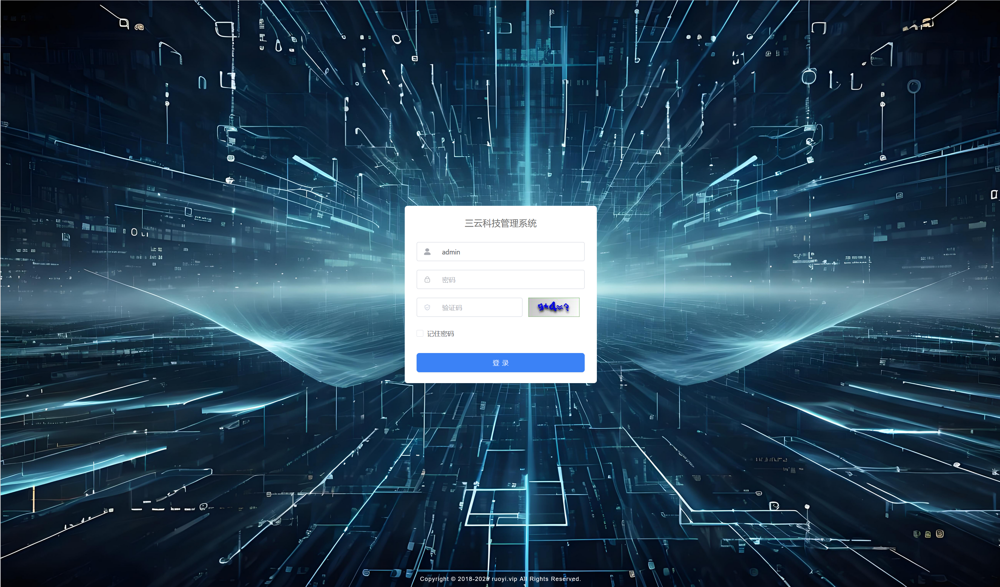
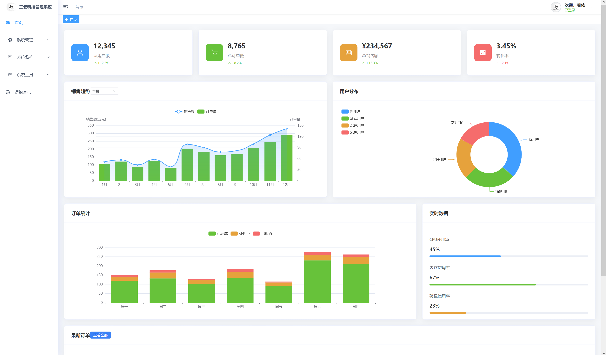
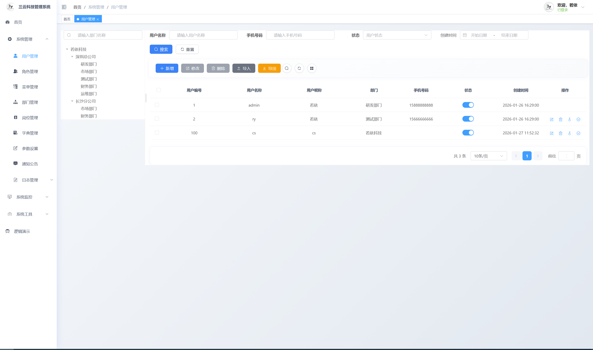
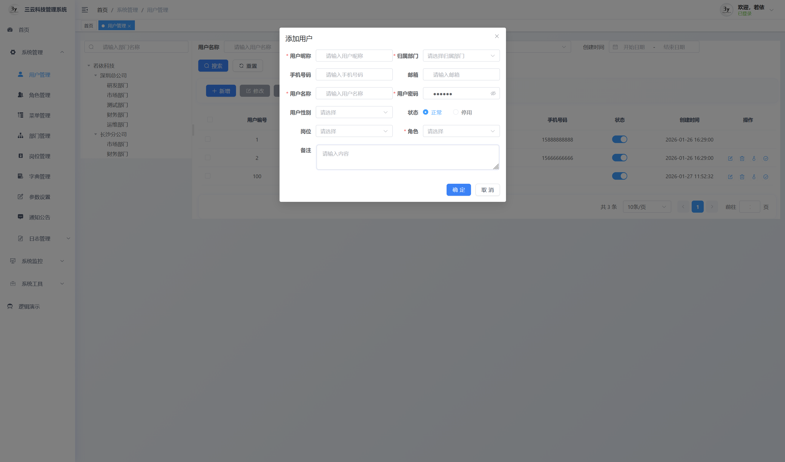
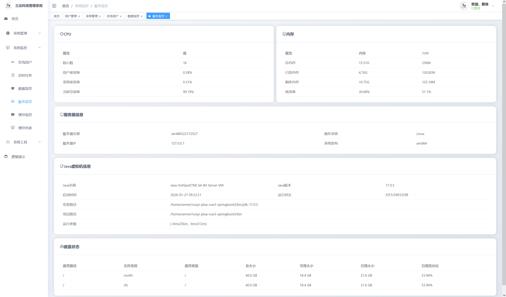
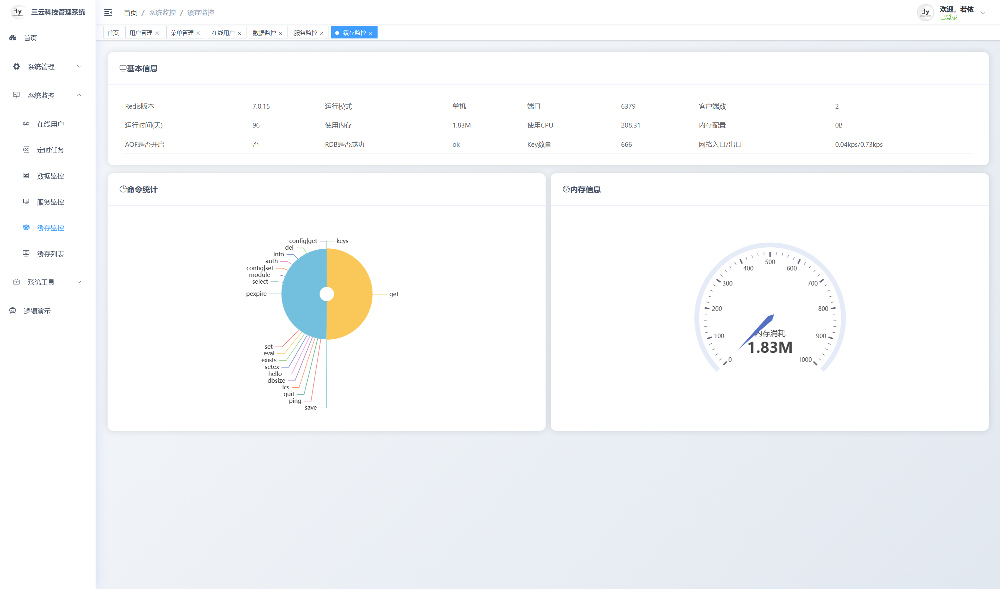
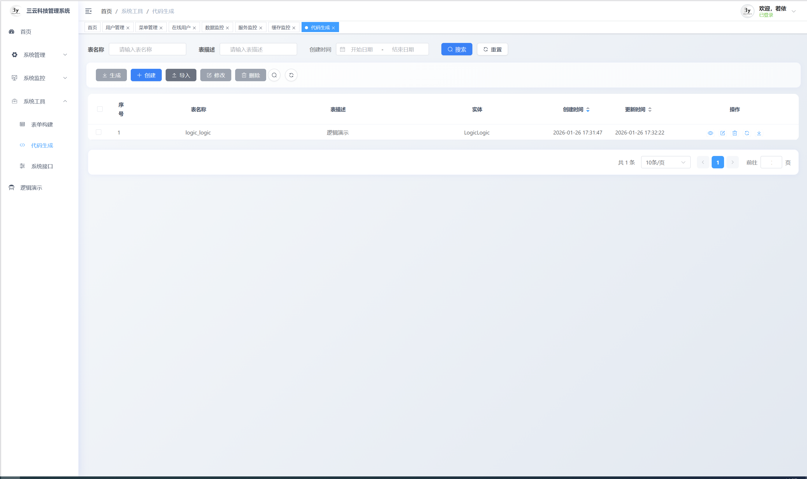
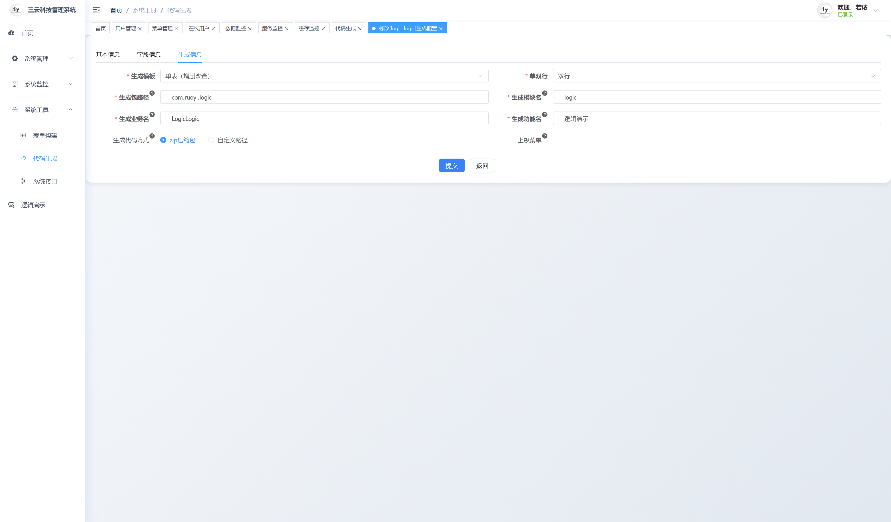

# RuoYi-Plus 后台管理系统

> 基于若依框架二次开发的企业级后台管理系统。

## 🌐 演示地址

- **在线演示**: [http://154.219.105.118:17777/](http://154.219.105.118:17777/) 账号密码：admin/admin123
- **技术论坛**: [https://3ylt.xyz/](https://3ylt.xyz/) - 分享电影、电视剧、软件、游戏等内容
- **公司首页**: [https://www.sanyunkeji.cn](http://www.sanyunkeji.cn)

**🎉 感谢您的关注和支持！**

如有问题或建议，欢迎提交 [Issue](https://gitee.com/heqy65552335/ruoyi-plus/issues) 或 [PR](https://gitee.com/heqy65552335/ruoyi-plus/pulls)

# **⚡ 承接各种外包项目，技术硬，质量好，成本低！**

### **📧 联系方式：[https://www.sanyunkeji.cn](http://www.sanyunkeji.cn)**

## 📖 平台简介

RuoYi-Plus 是基于若依（RuoYi）底层，升级到vue3+SpringBoot3的项目，进行了多项升级优化。

### ✨ 核心特性

- 🔐 **数据权限**: 优化的数据权限控制，支持部门级和用户级权限，弱化数据表字段限制
- 🔐 **前端美化**: 对前端进行了大量美化，更符合现代企业级后台管理系统的风格
- 🔐 **后端优化**: 集成了mybatis-plus，并做了代码生成器适配
- 🔐 **其他小功能优化**: 对其他小功能进行优化
## 🛠️ 技术架构

### 前端技术栈
- **框架**: Vue 3.x + Element Plus
- **构建工具**: Vite + TypeScript
- **状态管理**: Pinia
- **路由管理**: Vue Router 4.x
- **组合式API**: Composition API + `<script setup>`

### 后端技术栈
- **核心框架**: Spring Boot 3.x
- **安全框架**: Spring Security 6.x + JWT
- **数据库**: MySQL
- **缓存**: Redis
- **工具库**: Hutool + Lombok
- **接口文档**: Knife4j (Swagger)
- **JDK版本**: JDK 17+

## 📸 演示图片

### 系统界面展示

|                      登录界面                       |                      首页                       |
|:-----------------------------------------------:|:---------------------------------------------:|
|  |  |

|                      用户管理                       |                      用户管理                       |
|:-----------------------------------------------:|:-----------------------------------------------:|
|  |  |

|                      系统监控                       |                      缓存监控                       |
|:-----------------------------------------------:|:-----------------------------------------------:|
|  |  |

|                      代码生成                       |                      代码生成                       |
|:-----------------------------------------------:|:-----------------------------------------------:|
|  |  |

## 🙏 致谢

感谢以下开源项目和社区的支持：

- 🎯 **[若依 (RuoYi)](https://gitee.com/y_project/RuoYi-Vue)** - 提供了优秀的基础框架

## 💖 支持项目

如果这个项目对您有帮助，欢迎给个 ⭐ Star 支持一下！

您的每一份支持都是我持续维护和改进项目的动力！

### 赞助方式

|                      微信赞赏                       |                       支付宝赞赏                       |
|:-----------------------------------------------:|:-------------------------------------------------:|
|  |  |

---
