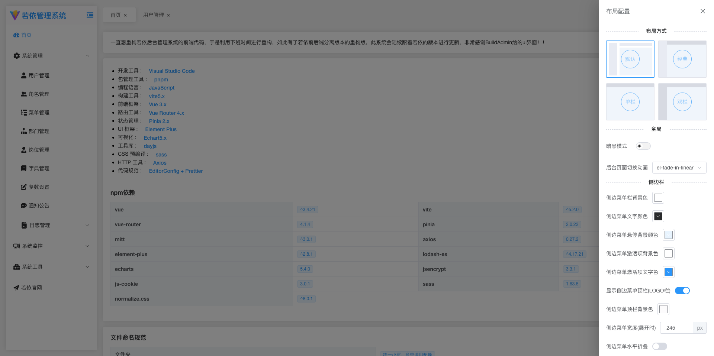
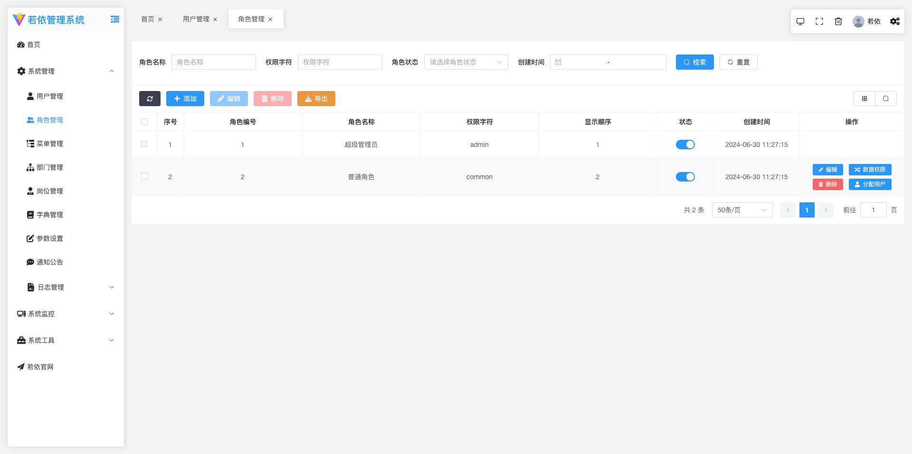
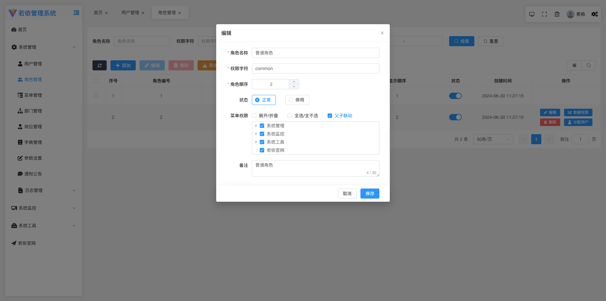
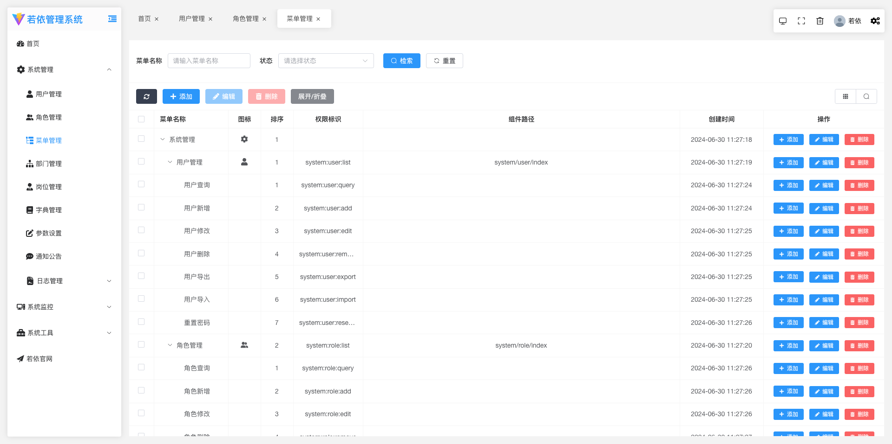
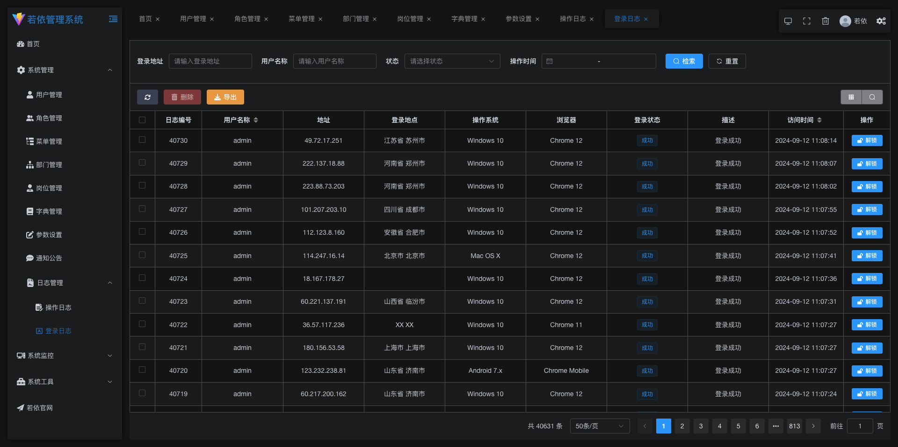
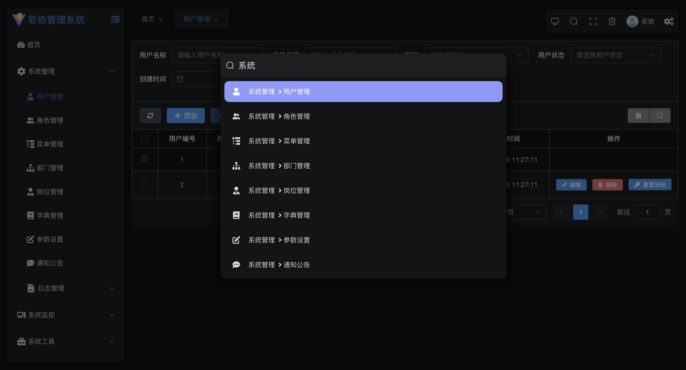

# 若依微服务版本-前端

## 项目介绍

1.  本项目可以完美的对接原版本的 ruoyi 前后端分离版本的后端
2.  本项目重构了若依前后端分离版本的前端 70%的代码，代码高度内聚，并优化了界面的 ui。

## 技术选型

- 开发语言：JavaScript
- 基础框架：Vue3.4.21
- 构建工具：Vite
- 组件库：Element-Plus
- 包管理器：pnpm
- ...

## Node 版本

- Node20.10.0 以上

## 前端运行

```bash
# 克隆项目
git clone https://gitee.com/codelm/ruoyi-vue3-lmw.git

# 进入项目目录
cd ruoyi-vue3-lmw

# 安装依赖
pnpm install

# 启动服务
pnpm dev

# 打包项目
pnpm build:prod

```

## 演示图

<table>
  <tr>
    <td></td>
    <td></td>
  </tr>
  <tr>
    <td></td>
    <td></td>
  </tr>
  <tr>
    <td></td>
    <td></td>
  </tr>
  <tr>
    <td></td>
    <td></td>
  </tr>
  <tr>
    <td></td>
    <td></td>
  </tr>
  <tr>
    <td></td>
    <td></td>
  </tr>
  <tr>
    <td></td>
    <td></td>
  </tr>
  <tr>
    <td></td>
    <td></td>
  </tr>
  <tr>
    <td></td>
    <td></td>
  </tr>
    <tr>
    <td></td>
    <td></td>
  </tr>
</table>

## 目录结构

```tree
├── BaseComponent				//脱离所有业务的组件
├── api									//网络请求
├── assets							//静态资源
├── components					//全局业务组件
├── directive						//全局指令
├── hooks								//hooks
├── layout							//布局
├── plugins							//通用方法
├── router							//路由
├── store								//全局 store管理
├── utils								//全局公用方法
├── views								//所有页面
├── App.vue             // 入口页面
└── main.js             // 入口 加载组件 初始化等
```

## 前端页面生成模板

参考 ruoyi-generator 文件夹

## 组件使用说明

### 1、BaseForm

#### 属性

| 属性名       | 说明                                                       | 类型         | 默认值                                                                                    |
| ------------ | ---------------------------------------------------------- | ------------ | ----------------------------------------------------------------------------------------- |
| elFormConfig | element-plus 的 Form 组件参数                              | `Object`     | {}                                                                                        |
| allDisabled  | 是否禁用所有操作框                                         | `boolean`    | false                                                                                     |
| formItems    | 需要渲染的 form 项，具体参考下方的 formItem                | `Array`      | []                                                                                        |
| v-model:data | 表单数据                                                   | `Object`     | 必填                                                                                      |
| itemStyle    | 每个 formItem 的样式                                       | `Object`     | { padding: '20px 20px 0px 0px' }                                                          |
| colLayout    | 单个 formItem 布局配置，参考 element-plus 的 Layout 组件   | `Object`     | { xl: 4, //1920<br/>lg: 6, //1200<br/>md: 8, //992<br/>sm: 12, //768<br/>xs: 24, //<768 } |
| footerLayout | footer 插槽的布局配置，参数同上                            | `Object`     | { xl: 3, //1920<br/>lg: 4, //1200<br/>md: 4, //992<br/>sm: 12, //768<br/>xs: 24, //<768 } |
| rowConfig    | 所有 formItem 的布局配置，参考 element-plus 的 Layout 组件 | `Object`     | {}                                                                                        |
| rules        | 表单正则校验，参考 element-plus 的表单校验                 | `Object`     | {}                                                                                        |
| hideItems    | 需要隐藏的列(需要用 ref 包裹)                              | `ref(Array)` | []                                                                                        |

##### formItem

| 属性名         | 说明                                                                                             | 类型      | 默认值 |
| -------------- | ------------------------------------------------------------------------------------------------ | --------- | ------ |
| field          | data 的键名                                                                                      | `String`  | —      |
| isHidden       | 是否隐藏该列                                                                                     | `Boolean` | false  |
| hideLabel      | 是否隐藏 label                                                                                   | `Boolean` | false  |
| label          | 标签文本                                                                                         | `String`  | —      |
| formItemConfig | 参考 element-plus 的 formItem 配置                                                               | `Object`  | —      |
| type           | 参考下方的 type                                                                                  | `String`  | —      |
| config         | 根据 type 的选择配置不同的 config，可以根据 type 的类型去查看 element-plus 的文档                | `Object`  | —      |
| eventFunction  | 组件的监听事件，根据 type 的类型去查看 element-plus 的文档                                       | `Object`  | —      |
| slotNames      | 根据 type 类型去查看对应 element-plus 组件的插槽配置，对外暴露的插槽名称为 field+驼峰的 slotName | `Array`   |        |

##### type

| 属性名称    | 说明                                                                          |
| ----------- | ----------------------------------------------------------------------------- |
| input       | 参考 element-plus 的 input，下面所有的 type 都可参考 element-plus             |
| password    | Input                                                                         |
| inputNumber | Input Number                                                                  |
| textarea    | Input                                                                         |
| cascader    | cascader                                                                      |
| select      | select                                                                        |
| tree        | Tree                                                                          |
| treeSelect  | TreeSelect                                                                    |
| datepicker  | DatePicker                                                                    |
| checkBox    | checkbox 组件，具体使用可以查看 BaseForm 的源代码，很容易看懂                 |
| radio       | radio，具体使用可以查看 BaseForm 的源代码，很容易看懂                         |
| custom      | 自定义类型，如何 type='custom'时会向外部暴露一个插槽，插槽名称为 field+Custom |

#### 插槽

| 插槽名       | 说明                     |
| ------------ | ------------------------ |
| field+Before | 每个 formItem 的前置插槽 |
| field+After  | 每个 formItem 的后置插槽 |
| footer       | 最尾部的插槽             |

### 2、BaseTable

#### 属性

| 属性名           | 说明                                                      | 类型             | 默认值                                    |
| ---------------- | --------------------------------------------------------- | ---------------- | ----------------------------------------- |
| dataList         | 表数据                                                    | `Array`          | []                                        |
| tableItem        | 参考下方的 tableItem                                      | `Array`          | []                                        |
| tableListener    | table 的监听事件参考 element-plus 的 table 组件的监听事件 | `Object`         | {}                                        |
| showChoose       | 是否展示复选框                                            | `Boolean`        | false                                     |
| showIndex        | 是否展示序号                                              | `Boolean`        | false                                     |
| pagination       | 是否显示分页                                              | `Boolean`        | true                                      |
| listCount        | 总条数                                                    | `Number`         | 0                                         |
| paginationInfo   | 分页的页码和偏移                                          | `Object`         | { pageNum: 1, pageSize: 50 }              |
| elTableConfig    | element-plus 的 table 组件的参数配置                      | `Object`         | {}                                        |
| showExpand       | 列表是否可展开                                            | `Boolean`        | false                                     |
| align            | 列布局，参考 element-plus 的 align                        | `String`         | center                                    |
| paginationLayout | 参考 element 的 pagination                                | `String`         | 'total, sizes, prev, pager, next, jumper' |
| hideItems        | 需要隐藏的列(需要用 ref 包裹)                             | `ref(Array)`     | []                                        |
| maxHeight        | 参考 element-plus 的 table 的 max-height                  | `Number, String` |                                           |
| selectionConfig  | element-plus 的 table 复选框的配置                        | `Object`         | {}                                        |

##### tableItem

| 属性名            | 说明                                                                                                            |
| ----------------- | --------------------------------------------------------------------------------------------------------------- |
| 参考 element-plus | 与 element-plus 的 table-column 参数一致                                                                        |
| slotName          | 对应 element-plus 中 Table-column 的 default 插槽                                                               |
| useOwn            | 是否使用 element-plus 的 Table-column 的 header 插槽，如果为 true 时会向外暴露一个名称为 slotName+Header 的插槽 |

### 3、pageSearch

#### 属性

| 属性名             | 说明                                                                         | 类型      | 默认值 |
| ------------------ | ---------------------------------------------------------------------------- | --------- | ------ |
| searchConfig       | 参考 BaseForm 组件的所有属性                                                 | `Object`  | {}     |
| initSearch         | 搜索参数初始化的值                                                           | `Object`  | {}     |
| otherRequestOption | 需要另外携带的查询条件                                                       | `Object`  | {}     |
| showSearch         | 是否展示检索和充值按钮                                                       | `Boolean` | true   |
| pageName           | 点击搜索时会使用 mitt 库发送一个名称为 search+pageName+Info 的事件，用于查询 | `String`  | 必填   |

#### Exposes

| 方法名      | 说明                         | 类型       |
| ----------- | ---------------------------- | ---------- |
| formData    | 搜索参数                     | `Object`   |
| search      | 检索按钮的方法               | `Function` |
| setFormData | 设置 formData 搜索条件的方法 | `Function` |

### 4、pageContent

#### 属性

| 属性名             | 说明                                                                                                                                                                                                                                            | 类型       | 默认值                                                               |
| ------------------ | ----------------------------------------------------------------------------------------------------------------------------------------------------------------------------------------------------------------------------------------------- | ---------- | -------------------------------------------------------------------- |
| contentConfig      | 参考 BaseTable 组件的所有属性                                                                                                                                                                                                                   | `Object`   | {}                                                                   |
| tableListener      | table 的监听事件参考 element-plus 的 table 组件的监听事件                                                                                                                                                                                       | `Object`   | {}                                                                   |
| firstSendOption    | 页面第一次进入的查询条件                                                                                                                                                                                                                        | `Object`   | —                                                                    |
| autoSend           | 页面加载是否自动发送查询请求                                                                                                                                                                                                                    | `Boolean`  | true                                                                 |
| autoDesc           | 是否自动加入排序的查询条件                                                                                                                                                                                                                      | `Boolean`  | true                                                                 |
| descConfig         | 排序的参数                                                                                                                                                                                                                                      | `Object`   | { orderByColumn: 'createTime', isAsc: 'desc' }                       |
| otherRequestOption | 其他查询条件                                                                                                                                                                                                                                    | `Object`   | {}                                                                   |
| showEdit           | 列表的列是否展示编辑按钮                                                                                                                                                                                                                        | `Boolean`  | true                                                                 |
| handleEditShow     | 返回一个 true 或 false 用户控制编辑按钮的显示                                                                                                                                                                                                   | `Function` | () => { return true }                                                |
| showDelete         | 列表的列是否展示编辑按钮                                                                                                                                                                                                                        | `Boolean`  | true                                                                 |
| handleDeleteShow   | 返回一个 true 或 false 用户控制删除按钮的显示                                                                                                                                                                                                   | `Function` | () => { return true }                                                |
| headerButtons      | 列表上方需要展示的按钮[刷新，添加，编辑，删除，隐藏列，搜索栏显示隐藏按钮]                                                                                                                                                                      | `Array`    | [ 'refresh', 'add', 'edit', 'delete', 'columnDisplay', 'comSearch' ] |
| tableSelected      | table 被选中的项，用于控制按钮的 disabled                                                                                                                                                                                                       | `Array`    | []                                                                   |
| permission         | 按钮权限控制 add，edit，del                                                                                                                                                                                                                     | `Object`   | {}                                                                   |
| idKey              | 删除按钮和编辑按钮点击时查询详情接口需要使用的列表的键                                                                                                                                                                                          | `String`   | —                                                                    |
| pageName           | 组件会使用 mitt 库监听 search+pageName+Search 事件                                                                                                                                                                                              | `String`   | —                                                                    |
| requestBaseUrl     | 页面会根据此配置发送请求                                                                                                                                                                                                                        | `String`   | /                                                                    |
| requestUrl         | 页面会根据此配置发送请求                                                                                                                                                                                                                        |            |                                                                      |
| 发送请求的规则     | url 为 requestBaseUrl+pageName+requestUrl                                                                                                                                                                                                       |            |                                                                      |
| 数据存储位置       | 列表数据统一用 pinia 存储，src/store/business/businessStore.js，存储在 listInfo 中，键为 pageName+List，所以务必让 pageName 唯一，以免出现数据错乱的问题。如果两个界面的请求接口相同，请在此 pinia 文件中的 interceptor 函数进行 url 配置修改。 |            |                                                                      |
| dictMap            | 数据字典对象，当 tableItem 中的 item 的键 isDict 为 true 且 slotName 有值时，会自动反显数据字典                                                                                                                                                 | `Object`   | {}                                                                   |

#### 插槽

| 插槽名               | 说明                   |
| -------------------- | ---------------------- |
| item.slotName+Header | 每一列的头部插槽       |
| handleLeft           | 列表上方按钮的左边插槽 |
| handleRight          | 列表上方按钮的右边插槽 |

#### Exposes

| 方法名          | 说明             | 类型       |
| --------------- | ---------------- | ---------- |
| finalSearchData | 搜索参数         | `Object`   |
| refresh         | 刷新方法         | `Function` |
| baseTabelRef    | BaseTable 的实例 |            |
| deleteRow       | 列表删除的方法   | `Function` |
| editClick       | 列表编辑的方法   | `Function` |
| dataList        | 列表数据         | `Array`    |

### 5、PageDialog

#### 属性

| 属性名         | 说明                                                    | 类型      | 默认值 |
| -------------- | ------------------------------------------------------- | --------- | ------ |
| infoInit       | form 表单的初始化值                                     | `Object ` | {}     |
| otherInfo      | 编辑或者新建时除了 formData 还要传的参数                | `Object ` | {}     |
| idKey          | 编辑按钮需要使用的列表的键                              | `String`  | —      |
| width          | 弹出层宽度                                              | `String`  | 600px  |
| top            | 弹出层距离顶部的距离                                    | `String`  | 10vh   |
| dialogConfig   | 参考 BaseForm 组件的所有属性                            | `Object ` | {}     |
| defaultData    | formData 默认值                                         | `Object ` | {}     |
| sendIdKey      | 发送请求时 id 的键名                                    | `String`  | —      |
| requestBaseUrl | 同 pageContent                                          | `String`  | —      |
| pageName       | 同 pageContent                                          | `String`  | 必填   |
| 请求 url 说明  | requestBaseUrl+pageName 需要修改可以在 pinia 文件中修改 |           |        |

#### Exposes

| 方法名      | 说明            | 类型       |
| ----------- | --------------- | ---------- |
| formData    | 表单数据        | `Object`   |
| setFormData | 设置表单数据    | `Function` |
| formRef     | BaseForm 的实例 | `Function` |

## 联系本人

本人微信：lmwcoder，欢迎大家提供建议，
无需捐赠，如果觉得项目不错，或者已经在使用了，希望你可以去帮我点个 ⭐ Star。

## 致谢

非常感谢[BuildAdmin](https://doc.buildadmin.com/)提供的 ui 界面
